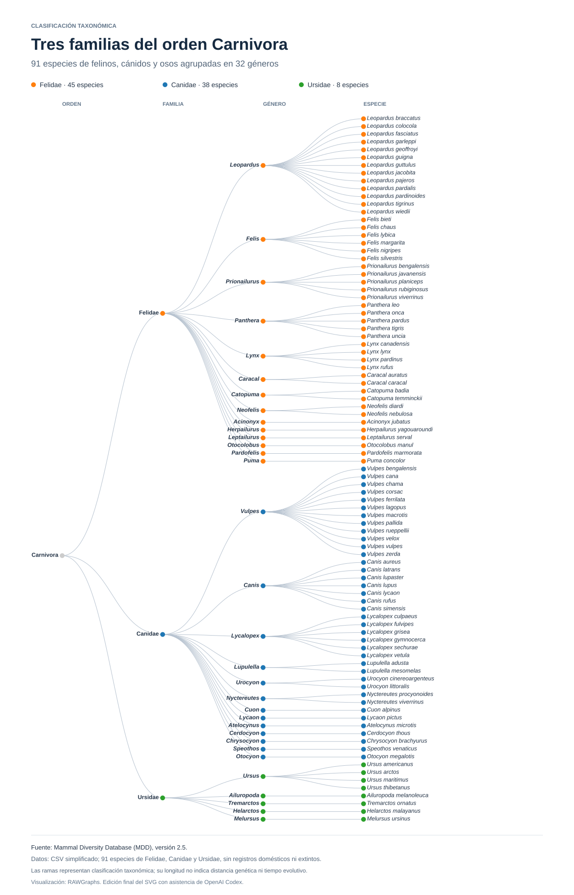

# Linear Dendrogram — Clasificación de mamíferos

Esta carpeta reúne el material del dendrograma lineal de la PEC 2 de Visualización de Datos, realizado en RAWGraphs.

El objetivo es representar la jerarquía taxonómica de los mamíferos del orden Carnivora incluidos en el dataset.

## Datos

El archivo [mamiferos.csv](data/mamiferos.csv) conserva sin modificaciones el CSV simplificado aportado para la actividad: `MDD_v2.5_6904species_Simplificado.csv`.

Los campos son `sciName`, `order`, `family` y `genus`. La jerarquía se interpreta como orden → familia → género → especie. El nombre del archivo original identifica la versión de partida; no indica el número de registros del archivo simplificado.

## Visualización

La exportación de RAWGraphs está disponible en [linear-dendrogram.svg](visualizacion/linear-dendrogram.svg). Se conserva el contenido del archivo aportado, con el nombre normalizado para mantener las rutas del proyecto.

La [página principal](https://uoc-luislopezesteso.github.io/PEC2-Visualizacion-Datos/#dendrograma) permite consultar el dendrograma y acceder a los datos. El gráfico muestra la jerarquía taxonómica; las longitudes de las ramas no deben interpretarse como distancias evolutivas.

[Volver al repositorio](../README.md)
